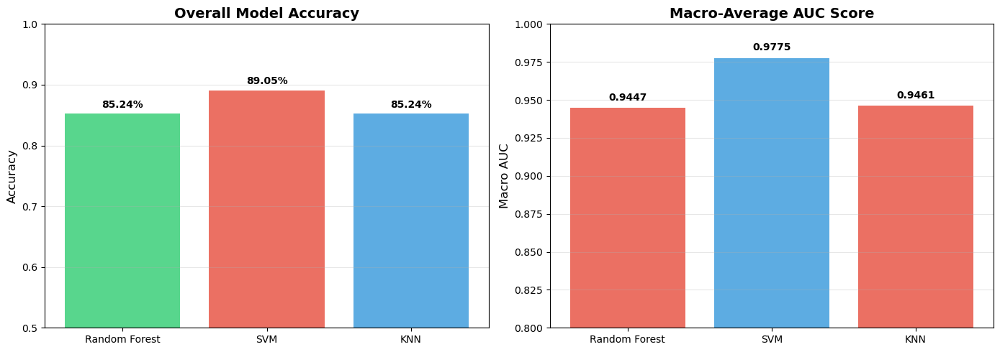
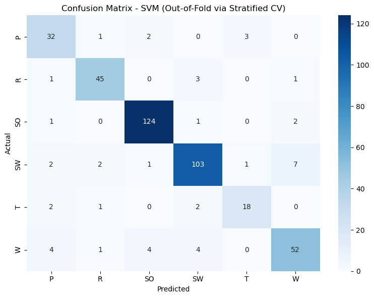

# Bird Ecological Group Classification from Skeletal Measurements

Classifying birds into six ecological groups using only measurements of their bones, by comparing three machine learning models: Random Forest, Support Vector Machine (SVM) and K-Nearest Neighbours (KNN).

The best model, a tuned **SVM, reaches 89.05% accuracy** and a **macro-average AUC of 0.978** under stratified 5-fold cross-validation.

*Coursework for the Foundations of Machine Learning module, MSc Artificial Intelligence, Liverpool John Moores University.*

## The problem

Can we tell how a bird lives (swimming, wading, hunting, singing...) just from the size of its bones? Each bird is described by 10 skeletal measurements, and the task is to predict which of six ecological groups it belongs to.

## Dataset

- **420 birds**, each with **10 features**: the length and width of five bones (humerus, ulna, femur, tibiotarsus and tarsometatarsus), in millimetres.
- **6 classes**, which are imbalanced:

| Group | Code | Birds |
| --- | --- | --- |
| Singing birds | SO | 128 |
| Swimming birds | SW | 116 |
| Wading birds | W | 65 |
| Raptors | R | 50 |
| Scansorial birds | P | 38 |
| Terrestrial birds | T | 23 |

- 15 values were missing (1 to 3 per feature) and were filled with the mean of their column.

## Approach

1. **Exploratory analysis:** class distribution, feature distributions, correlations, and mutual information between each feature and the class.
2. **Evaluation:** stratified 5-fold cross-validation, chosen over a single train/test split because the dataset is small and imbalanced.
3. **Models:** Random Forest, SVM and KNN, each trained first with default settings, then tuned with `GridSearchCV`. SVM and KNN use a `StandardScaler` pipeline.
4. **Metrics:** accuracy, precision, recall, F1-score, specificity, confusion matrices, ROC curves and AUC.
5. **Interpretation:** feature importance (Random Forest) and permutation importance (SVM and KNN).
6. **Inference:** the final model predicts the group of new, user-entered measurements.

## Results

| Model | Accuracy (default) | Accuracy (tuned) | Macro AUC (tuned) |
| --- | --- | --- | --- |
| **SVM** (RBF kernel, C = 100) | 67.14% | **89.05%** | **0.978** |
| KNN (k = 3, distance-weighted) | 76.43% | 85.24% | 0.946 |
| Random Forest | 84.76% | 85.24% | 0.945 |



**Key findings**

- **SVM gained the most from tuning**, rising by about 22 points, and became the best model overall.
- **Singing birds** were the easiest group to recognise (F1-score 95.8% with SVM).
- **Wading and swimming birds** were most often confused with each other, which suggests their skeletons are similar.



## How to run

```bash
git clone https://github.com/NihadAsfirane/bird-classification-skeletal-measurements.git
cd bird-classification-skeletal-measurements
pip install -r requirements.txt
jupyter notebook bird_classification.ipynb
```

The last cells ask you to type in measurements for a new bird and predict its group.

## Tools

Python · scikit-learn · pandas · NumPy · Matplotlib · seaborn · Jupyter
